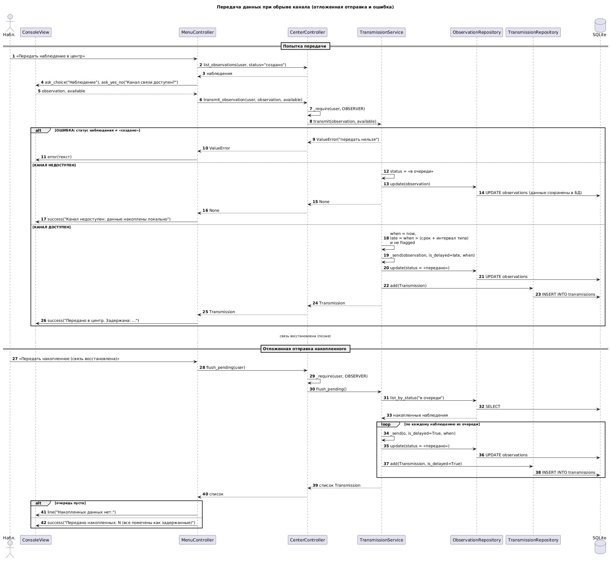
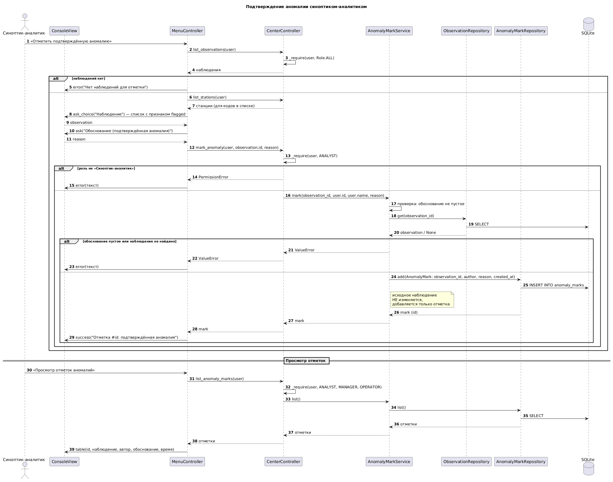
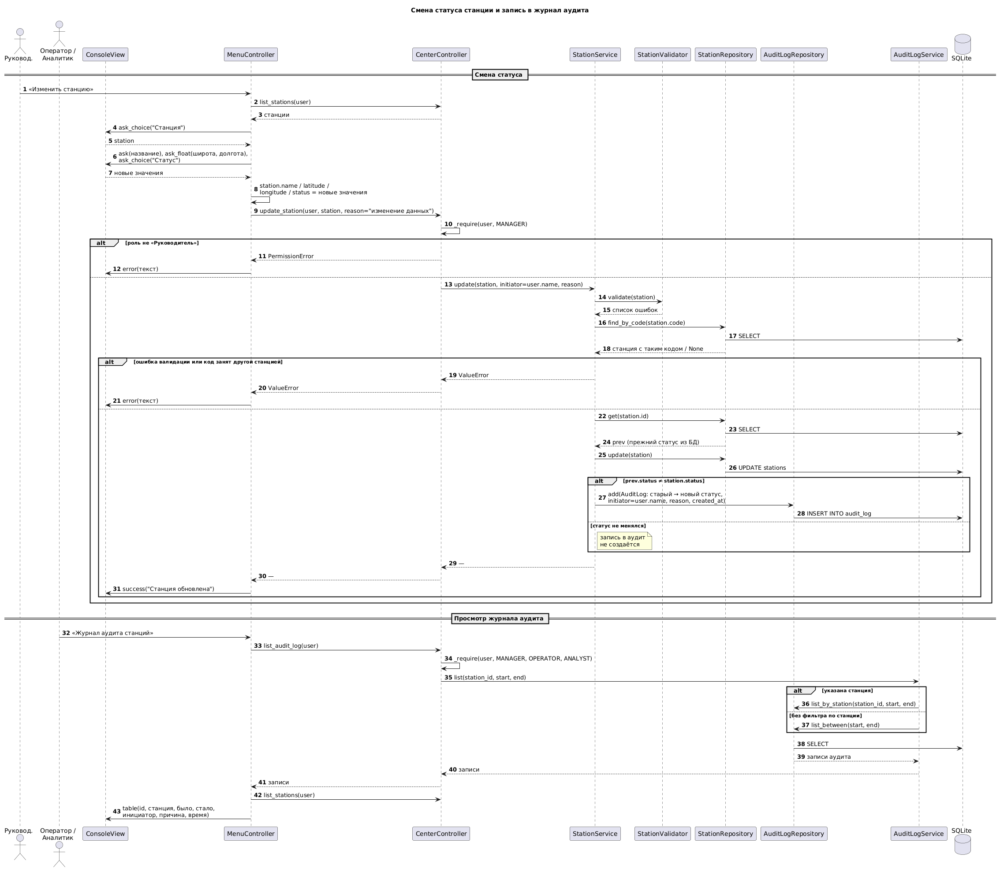

# Диаграммы последовательности: система метеорологической сети

## Общая архитектура

Система построена по схеме MVC. Во всех диаграммах участвуют одни и те же слои:

| Слой | Участники | Роль |
| --- | --- | --- |
| View | `ConsoleView` | Вывод сообщений и запрос данных у пользователя |
| Controller | `MenuController`, `CenterController` | Диалог с пользователем; проверка роли (`_require`) и передача вызова в Model |
| Model (сервисы) | `StationService`, `TransmissionService`, `AnomalyMarkService`, `AuditLogService` | Бизнес-правила |
| Model (данные) | `*Repository`, `StationValidator`, SQLite | Хранение и проверка корректности |

Ошибки Model (`ValueError`) и отказы в доступе (`PermissionError`) доходят до `MenuController` и показываются через `view.error()`, программа при этом не завершается.

Роли: наблюдатель, оператор центра, руководитель, синоптик-аналитик.

---

## 1. Саморегистрация станции и подтверждение

## Саморегистрация станции и подтверждение

**Цель.** Показать, как новая станция сама подключается к сети и затем включается в работу руководителем.

**Участники.** Автоматическая станция, руководитель, `CenterController`, `StationService`, `StationValidator`, `StationRepository`, `AuditLogRepository`, SQLite.

**Ход событий.**

Автоматическая станция при первом подключении передаёт код, название, координаты и тип. `CenterController` вызывает `StationService.register(pending=True)`: станция создаётся со статусом «ожидает подтверждения», данные проверяются валидатором, код проверяется на уникальность. При успехе станция сохраняется в БД, в журнал аудита пишется запись с инициатором «система». До подтверждения данные станции могут накапливаться, но в сводки (`all_active`) не входят.

Руководитель запрашивает список станций в статусе «ожидает подтверждения», выбирает станцию и указывает причину. `StationService.confirm` переводит статус в «активна», обновляет запись в БД и добавляет в аудит переход «ожидает подтверждения → активна» с именем инициатора и причиной.

**Ветки и ошибки.**

Ошибка валидации или занятый код → `ValueError`, станция не создаётся. Подтвердить можно только станцию в статусе «ожидает подтверждения»; иначе → `ValueError`. Подтверждение доступно только роли руководителя (`PermissionError` для остальных).

---

## 2. Передача данных при обрыве канала

**Цель.** Показать, что происходит с наблюдением при недоступном канале связи и как накопленные данные уходят в центр после восстановления связи.

**Участники.** Наблюдатель, `MenuController`, `CenterController`, `TransmissionService`, `ObservationRepository`, `TransmissionRepository`, SQLite.

**Об асинхронности.** Сама передача в коде синхронная. Асинхронное поведение реализовано через очередь в БД: при обрыве наблюдение получает статус «в очереди» и отправляется позже отдельным действием. Данные хранятся в БД, а не в памяти, и не теряются при перезапуске.

**Ход событий.**

1. Наблюдатель выбирает наблюдение в статусе «создано» и указывает, доступен ли канал.
2. `TransmissionService.transmit` проверяет статус и выбирает одну из веток:
   - **Ошибка.** Статус не «создано» → `ValueError`, передать нельзя.
   - **Канал недоступен.** Статус → «в очереди», запись обновляется в БД, метод возвращает `None`. Пользователь видит, что данные накоплены локально.
   - **Канал доступен.** Наблюдение отправляется. Передача задержана, если время отправки позже срока наблюдения + интервал типа (3 ч для срочных, 6 ч для промежуточных). Исправленное после перепроверки наблюдение задержанным не считается. Создаётся `Transmission`, статус → «передано».
3. Когда связь восстановлена, наблюдатель выбирает «Передать накопленное». `flush_pending` читает все наблюдения «в очереди» и отправляет каждое с `is_delayed=True`.

**Ветки и ошибки.** Если очередь пуста — «Накопленных данных нет». Все данные из очереди считаются задержанными.

---

## 3. Подтверждение аномалии (синоптик-аналитик)

**Цель.** Показать, как аналитик фиксирует, что выброс — реальное явление, а не ошибка измерения.

**Участники.** Синоптик-аналитик, `MenuController`, `CenterController`, `AnomalyMarkService`, `ObservationRepository`, `AnomalyMarkRepository`, SQLite.

**Ход событий.**

1. Аналитик выбирает «Отметить подтверждённую аномалию». Показывается список наблюдений с признаком `flagged` (отмечены контролем качества).
2. Он выбирает наблюдение и вводит обоснование.
3. `CenterController.mark_anomaly` проверяет роль «синоптик-аналитик».
4. `AnomalyMarkService.mark` проверяет, что обоснование не пустое и наблюдение существует.
5. В таблицу отметок добавляется `AnomalyMark` (наблюдение, автор, обоснование, время).

**Ключевое правило.** Исходное наблюдение **не изменяется** — добавляется только отдельная отметка. Первичные данные сохраняются; видно, что было измерено и кто почему признал это аномалией.

**Дополнительно.** Просмотр отметок доступен аналитику, руководителю и оператору.

**Ветки и ошибки.**

- Нет наблюдений → «Нет наблюдений для отметки».
- Другая роль → `PermissionError`.
- Пустое обоснование или наблюдение не найдено → `ValueError`.

---

## 4. Смена статуса станции и аудит

**Цель.** Показать, как изменение статуса станции проверяется и фиксируется в журнале аудита.

**Участники.** Руководитель; для просмотра журнала — также оператор и аналитик; `MenuController`, `CenterController`, `StationService`, `StationValidator`, `StationRepository`, `AuditLogRepository`, `AuditLogService`, SQLite.

**Ход событий (смена статуса).**

1. Руководитель выбирает «Изменить станцию», выбирает станцию и вводит новые данные, в том числе статус.
2. `CenterController.update_station` проверяет роль «руководитель».
3. `StationService.update` валидирует станцию и проверяет, что код не занят другой станцией.
4. Из БД читается прежняя версия, затем запись обновляется.
5. Если статус изменился, в журнал аудита добавляется запись: старый статус, новый статус, инициатор, причина, время. Если статус не менялся, запись не создаётся.

**Ход событий (просмотр журнала).** Журнал доступен руководителю, оператору и аналитику. `AuditLogService.list` выбирает записи по станции или за период; выводится таблица: станция, было, стало, инициатор, причина, время.

**Примечание.** В коде есть `StationService.change_status` (причина обязательна). В текущем меню он не подключён, поэтому на диаграмме основной путь — через «Изменить станцию».

**Ветки и ошибки.** Не руководитель → `PermissionError`. Ошибка валидации или дубликат кода → `ValueError`.

---

## Сводка по ролям и правам

| Операция | Допустимые роли |
| --- | --- |
| Саморегистрация станции | Руководитель, оператор, наблюдатель |
| Подтверждение станции | Руководитель |
| Изменение станции и статуса | Руководитель |
| Передача наблюдения и накопленного | Наблюдатель |
| Отметка аномалии | Синоптик-аналитик |
| Просмотр отметок аномалий | Аналитик, руководитель, оператор |
| Просмотр журнала аудита | Руководитель, оператор, аналитик |
